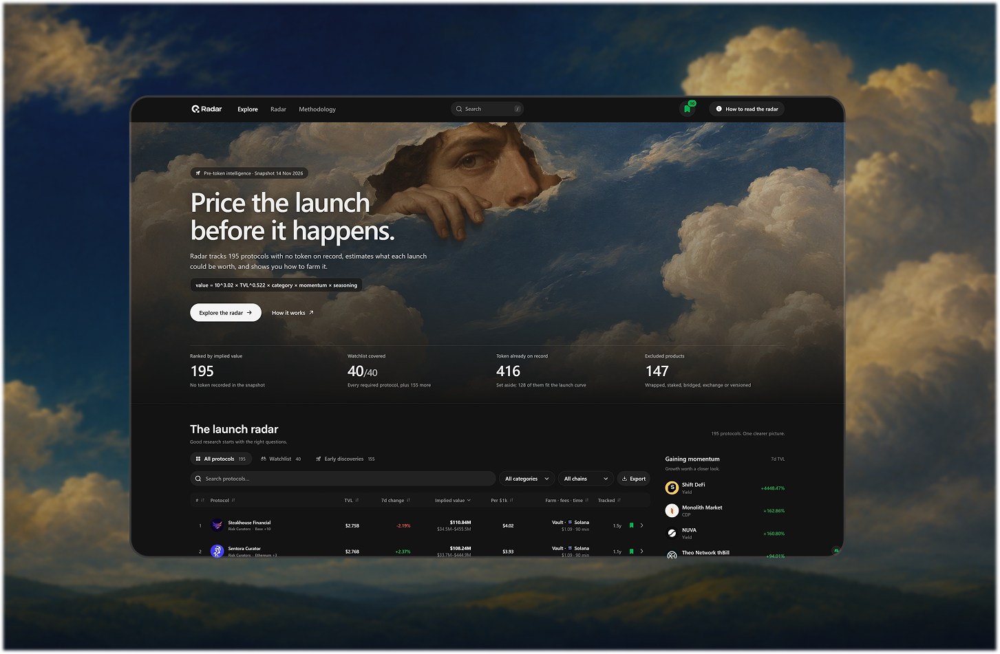
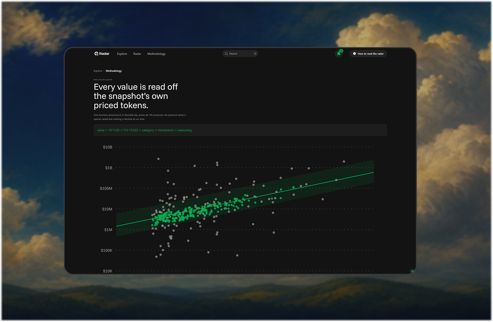

# Radar

**Research protocols before a potential token launch.**

Radar is a React dashboard for exploring DeFi protocols, comparing modelled valuations, and building a research shortlist from a fixed DefiLlama snapshot. It pairs a sortable protocol board with detailed valuation explanations and practical research plans.


## Explore



- Browse, search, sort, and filter protocols by category and chain.
- Compare TVL, changes, implied values, and valuation ranges.
- Open a protocol to inspect its valuation, comparables, charts, and research plan.
- Save protocols in your browser and revisit them from the Saved page.
- Use the Radar view to monitor the snapshot and press `/` to open search.

## Methodology



Radar separates protocols with a token recorded in the snapshot from candidates with no token recorded. Token-recorded protocols with both TVL and market-cap data form the comparable set. The model fits a curve in log space and applies bounded category, momentum, and seasoning factors:

```text
implied value = 10^intercept × TVL^elasticity × category × momentum × seasoning
```

The dashboard also shows a range derived from the distribution of comparable tokens around the curve. The methodology page explains the factors, assumptions, and limits in detail; the implementation lives in [`lib/radar.mjs`](lib/radar.mjs).

**Interpretation:** An implied value is a model estimate for research, not a token price or forecast. A missing token record does not prove that a protocol has no token. Research plans and fee estimates are illustrative; eligibility, rewards, and transaction costs must be verified independently.

## Getting started

### Requirements

- Node.js 22.18 or newer
- pnpm

### Install and run

```sh
git clone https://github.com/edison-alpha/Radar.git
cd Radar
pnpm install --frozen-lockfile
pnpm dev
```

Open [http://127.0.0.1:5173/](http://127.0.0.1:5173/). The development command prepares local images, icons, fonts, and snapshot data before starting Vite.

### Build and preview

```sh
pnpm build
pnpm preview
```

The production build is written to `dist/`. The application uses locally prepared snapshot data and assets; it does not fetch protocol data at runtime.

## Install and use offline

Serve the production build over HTTPS or localhost. Open it in a supported browser and use the browser's install or “Add to Home Screen” action. After the first visit finishes loading, the installed app can reopen offline using its cached dashboard, logos, and snapshot. A newer snapshot is fetched when the server is reachable; the displayed snapshot date identifies the data in use. Service workers do not run when opening the page directly with `file://`.

## Commands

| Command | Purpose |
| --- | --- |
| `pnpm dev` | Prepare assets and data, then start the development server. |
| `pnpm data` | Regenerate the browser payload and board from the snapshot. |
| `pnpm build` | Prepare the project and create the static build and dashboard artifacts. |
| `pnpm preview` | Preview the production build locally. |
| `pnpm test` | Run the data, model, and protocol-logo tests. |
| `pnpm test:render` | Run DOM-based application rendering checks. |
| `pnpm verify` | Check the generated build and dashboard artifacts; run `pnpm build` first. |
| `pnpm format` | Format the source, scripts, and tests. |
| `pnpm logos:fetch` | Refresh protocol logos from the configured sources. |
| `pnpm history:fetch` | Fetch TVL history for local preparation. |
| `pnpm chains:fetch` | Fetch chain logos for local preparation. |

The fetch commands are explicit development operations and require network access. Normal startup uses the files already included in the project.

## Project structure

```text
src/
  app/                  Application composition and routing
  components/           Shared UI and chart components
  features/             Explorer, protocol details, Radar, Saved, and methodology
  layout/               Header, footer, and status components
  shared/               Shared formatting, icons, and hooks
  styles/               Styles and responsive layouts
  assets/images/        Project images
lib/radar.mjs           Classification, valuation model, and research plans
data/                   Input snapshot and generated board data
public/                 Browser data and locally stored assets
scripts/                Preparation, build, and verification scripts
tests/                  Data, model, and asset tests
docs/                   Source records and project documentation
```

## Data and assets

The included snapshot is processed locally by `lib/radar.mjs` and `scripts/prepare-data.mjs`. Dates and derived model values are based on the snapshot, not the current clock. Replacing the snapshot and regenerating the data can change the protocol universe, rankings, and estimates.

Protocol logos are stored in `public/protocol-logos/`. Source and identity records are documented in [`docs/protocol-logo-provenance.json`](docs/protocol-logo-provenance.json), with UI mappings in [`src/data/protocol-logos.json`](src/data/protocol-logos.json).

## Testing

```sh
pnpm test
pnpm build
pnpm test:render
pnpm verify
```

The unit tests cover snapshot classification, model behavior, determinism, and logo assets. The render checks exercise application flows in a DOM simulator; they do not replace visual testing in a browser.

## License

See [LICENSE](LICENSE).
